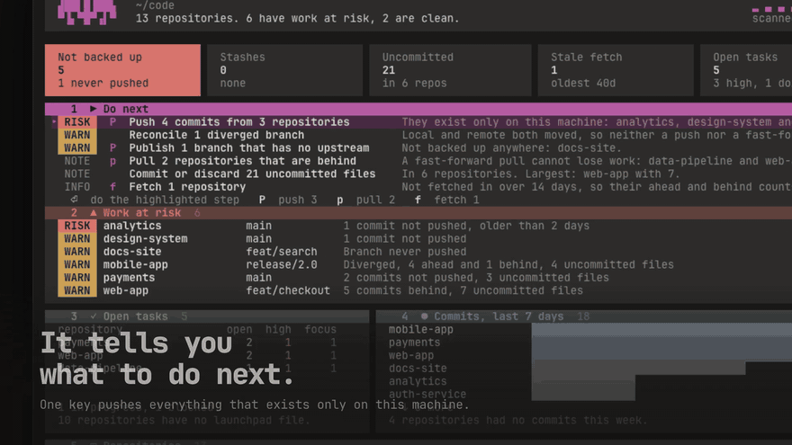
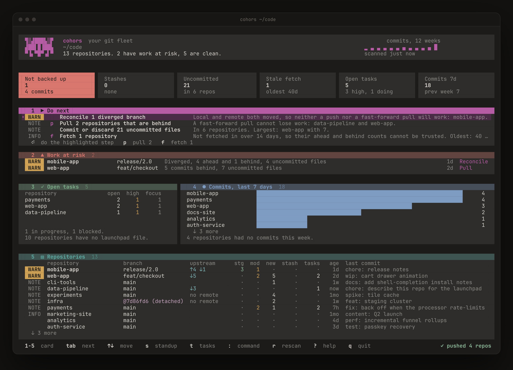
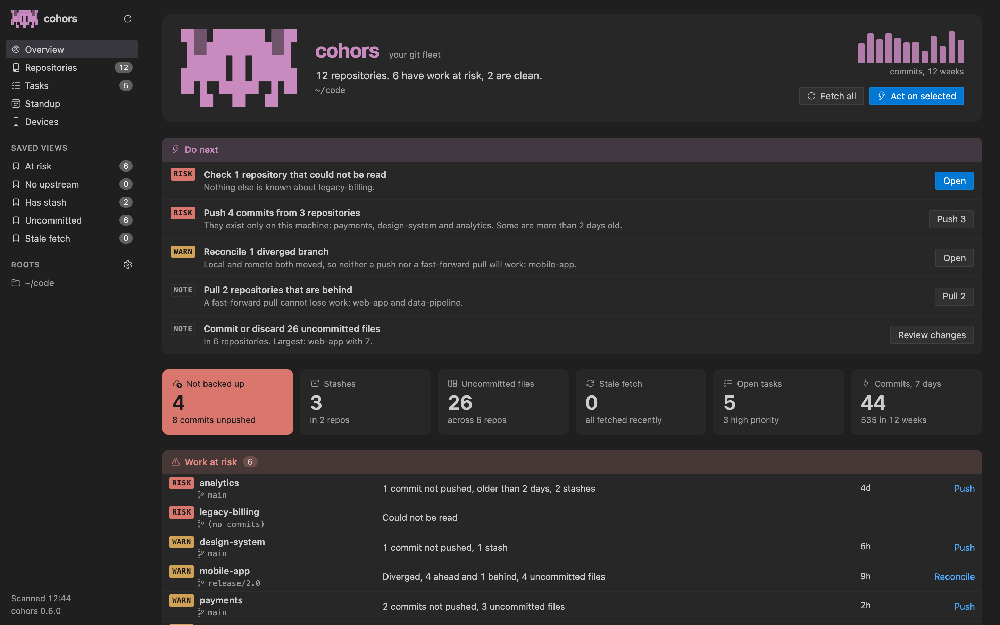
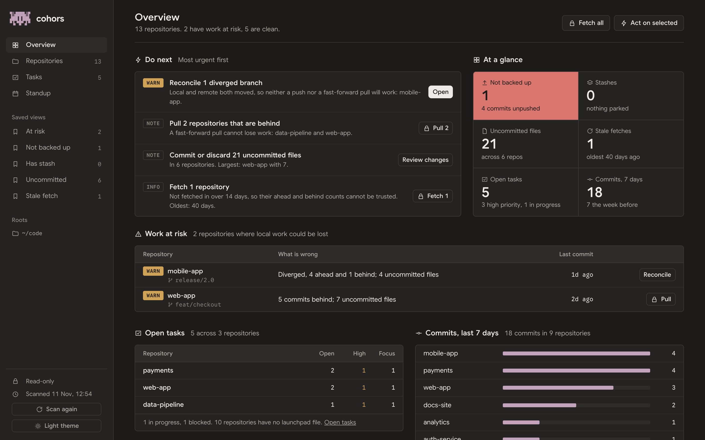

<div align="center">

<picture>
  <source media="(prefers-color-scheme: dark)" srcset="assets/readme/cohors-dark.png">
  
</picture>

### Every git repo you own, on one screen.

What is unpushed, what is behind, what is about to be lost, and what to do next,<br>across every repository on your machine. In your terminal, your editor, your browser and your coding agent.

[](https://github.com/rushirb2001/cohors/actions/workflows/ci.yml)
[](https://github.com/rushirb2001/cohors/releases)
[](LICENSE)
[](https://www.rust-lang.org/)

[**Install**](#install) &emsp; [**With Claude Code**](#use-it-with-claude-code) &emsp; [**Terminal**](#use-it-in-the-terminal) &emsp; [**VS Code**](#use-it-in-vs-code) &emsp; [**Browser**](#use-it-in-the-browser) &emsp; [**Launchpad**](#the-launchpad)



<sub>A real run on thirteen sample repositories with real remotes. One key pushes the four that existed only on this machine;<br>the fifth has diverged from its remote, so cohors leaves that one to you.</sub>

</div>

## Try it in a minute

```sh
brew install rushirb2001/tap/cohors
cohors
```

cohors looks in the folders where code usually lives and opens a dashboard of every repository it finds. Nothing is written until you press a key that says so. To look around on sample data first, run `cohors demo`. Other ways to install are [below](#install).

Every example in this README is real output from cohors, run on the same thirteen sample repositories as the picture above.

## Five questions a pile of terminals cannot answer

| | |
|---|---|
| **What only exists on this laptop?** | Commits never pushed and branches never published, counted and named. |
| **What should I do first?** | A short list of steps, most urgent first: push, publish, pull, review. |
| **Where is work about to be lost?** | Every repository at risk, with the reason and the step that fixes it. |
| **What did I ship this week?** | Your commits across every repository, ready to paste into a standup. |
| **What is waiting in each repo?** | Open tasks and the commands to run, written down in the repo itself. |

One Rust binary reads your repositories once, and the terminal, the editor, the browser and your agent all draw from that same reading, so they always agree.

## Use it with Claude Code

Claude can already run `git` in one repository at a time. With cohors it sees all of them at once: it answers "what needs my attention" in one call instead of `cd`-ing through every folder, and it can act across many repositories behind limits you set.

### 1. Connect it

Install the plugin from inside Claude Code:

```text
/plugin marketplace add rushirb2001/cohors
/plugin install cohors@cohors
```

Or from your shell: `claude plugin marketplace add rushirb2001/cohors && claude plugin install cohors@cohors`.

The plugin needs the `cohors` binary installed ([any channel](#install) works; the plugin finds it wherever it landed). It gives Claude:

| | |
|---|---|
| **The cohors MCP server** | Every read tool below. It starts read-only: Claude can look at anything and change nothing until you [turn on its settings](#3-let-claude-act). |
| **Three skills** | `fleet` (questions about all your repos), `launchpad-setup` ("set up this repo for the launchpad") and `plan-focus` ("plan my day"). Claude picks them up from what you ask. |
| **Two subagents** | `cohors-setup` writes a repo's launchpad file; `cohors-plan` plans your focus across repos. |
| **Session hooks** | Each Claude session's start and end is logged, so the launchpad shows which repos you worked in with an agent. |

Check it worked: start a new session and ask **"what needs my attention across my repos?"**. Claude should answer from the `overview` tool rather than running `find` or `git status`.

### 2. Ask it things

These are things to say to Claude, the tool it calls, and what that tool really returns on the sample fleet. Claude then answers in its own words from that result.

**"What needs my attention across my repos?"**

Claude calls `overview` and gets every step worth taking, most urgent first, each with the reason and the repositories it applies to:

```text
{
  "headline": "13 repositories. 6 have work at risk, 2 are clean.",
  "actions": [
    {
      "severity": "risk",
      "title": "Push 4 commits from 3 repositories",
      "why": "They exist only on this machine: analytics, design-system and payments. …"
    },
    {
      "severity": "warn",
      "title": "Reconcile 1 diverged branch",
      "why": "Local and remote both moved, so neither a push nor a fast-forward pull …"
    },
    { "severity": "warn", "title": "Publish 1 branch that has no upstream", … },
    { "severity": "notice", "title": "Pull 2 repositories that are behind", … },
    …
  ]
}
```

**"What have I changed in web-app?"**

Claude calls `changes` with `{"name": "web-app"}` and sees each uncommitted file (it can ask for the diff too, with `include_patch`):

```text
{
  "repo": "web-app",
  "files": [
    { "path": "cart.tsx",     "status": " M" },
    { "path": "checkout.tsx", "status": "??" },
    { "path": "drawer.tsx",   "status": "??" },
    { "path": "tax.ts",       "status": "??" },
    …
  ]
}
```

**"Where do we handle retries?"**

Claude calls `search` with `kind: "content"` and searches every repository at once, without opening any of them:

```json
{
  "hits": [
    { "repo": "payments", "path": "notes.md", "line": 6,
      "text": "fix: duplicate charge on retry" },
    { "repo": "payments", "path": "notes.md", "line": 9,
      "text": "fix: retry charge on 5xx from the processor" }
  ]
}
```

**"Write my standup for this week."**

Claude calls `standup` and gets your own commits (matched by your git email) grouped by repository, most active first. The same digest from the command line, `cohors standup`:

```markdown
## Standup — this week

_18 commits across 9 repos_

### mobile-app (4)
- `f709cc0` feat: biometric unlock
- `24a0e1d` test: unlock flows
- `05ff817` fix: token refresh race

### payments (4)
- `169e66b` fix: back off when the processor rate-limits
- `aba968d` feat: idempotency keys on retries
…
```

**"Back up everything that only exists on this laptop."**

This one changes things, so Claude works in three steps: find, preview, act. It finds the repos with `overview`, then previews the push with `dry_run`, which works even on a read-only server and touches nothing:

```json
{
  "action": "push",
  "dry_run": true,
  "targets": 4,
  "repos": [
    { "name": "mobile-app" }, { "name": "payments" },
    { "name": "design-system" }, { "name": "analytics" }
  ]
}
```

Claude shows you that list and waits for your yes. Then it pushes, if you have [let it act](#3-let-claude-act). Until then the real push is refused, and the refusal tells Claude (and you) which setting to turn on:

```text
`push` is disabled: this server is read-only. … This server was started by the
cohors plugin, so turn on its "Git actions" setting instead: `/plugin configure
cohors@cohors` in Claude Code, or `claude plugin configure cohors@cohors` in a
shell. Then start a new session.
```

`push` never force-pushes, and `pull` is fast-forward only, so neither can lose work. A diverged branch (mobile-app here) is reported as failing, never forced.

**"Run the tests in web-app and payments."**

Claude calls `run` with `dry_run` to show where the command would run, then again with `confirm: true` once you agree. Each repository reports its own exit code and output, and a command that runs too long is stopped and marked as timed out. This needs `--allow-run`.

**"Set up this repo for the launchpad."**

Say it inside a repository. The `launchpad-setup` skill has Claude read the [launchpad contract](#the-launchpad) and the repository itself (README, build files, compose files), and write `.cohors/repo.json`: the commands worth running and the work in progress. It leaves out anything cohors already detects on its own, checks the file before writing, and never commits. The sample `payments` repo's file looks like this:

```json
{
  "specVersion": 1,
  "name": "payments",
  "summary": "Charges, refunds and webhooks for every product",
  "group": "backend",
  "flows": [
    { "id": "dev", "label": "Run locally", "kind": "server",
      "run": "docker compose up -d && cargo run", "primary": true },
    { "id": "test", "label": "Test", "kind": "test", "run": "cargo test" }
  ],
  "tasks": [
    { "id": "idempotency-keys", "title": "Idempotency keys on charge retries",
      "status": "doing", "priority": "high" },
    { "id": "webhook-backoff", "title": "Back off webhook redelivery",
      "status": "todo", "priority": "normal" }
  ]
}
```

**"Plan my day."**

The `plan-focus` skill has Claude gather evidence before planning: `overview` for what is at risk, `read_board` for what you were already doing, `launchpad` for every repo's open tasks, `list_repos` for uncommitted or unpushed work nobody wrote a task for, and `standup` for what actually moved this week. It keeps everything you are still doing, proposes a short list with the first thing to start, and saves it to your focus board, which on the sample fleet holds:

```json
{
  "focus": [
    { "repo": "payments", "status": "doing",
      "title": "Idempotency keys on charge retries" },
    { "repo": "web-app", "status": "todo",
      "title": "Cart drawer animation" },
    { "repo": "data-pipeline", "status": "todo",
      "title": "Reprocess late events without a full backfill" }
  ]
}
```

The board lives in `~/.cohors/board.json`, and the terminal, VS Code and the browser all show it.

**"Which of my pull requests are failing CI?"**

Claude calls `ci_status` with `{"ci": "failing"}` and `list_prs`. These read GitHub, so they need a token: cohors uses `GITHUB_TOKEN`, or your `gh` login. The token never leaves your machine.

<details>
<summary><b>Every tool, and the selector they share</b></summary>
<br>

| Tool | What Claude gets |
|---|---|
| `overview` | What to do next across the fleet and why, most urgent first. The best first call. |
| `fleet_summary` | Counts only: total, needing attention, at risk. The cheapest check. |
| `list_repos` | Every repository's state: branch, ahead and behind, uncommitted files, stashes, last commit. |
| `get_repo` | One repository in depth. |
| `changes` | The uncommitted files in each repository, with the diff on request. |
| `search` | Code (`kind: "content"`) or repository names across the whole fleet. |
| `standup` | Your commits for this week or today, grouped by repository. |
| `repo_path` | Where a repository is on disk. |
| `list_prs`, `ci_status` | Open pull requests and CI results from GitHub. |
| `launchpad`, `read_contract`, `read_board` | Each repo's tasks and commands, the file format, and your focus board. |
| `fetch`, `pull`, `push`, `commit`, `stash` | Git across many repositories. Needs `--allow-writes`; `commit` and `stash` also need `confirm`. |
| `run` | One shell command in each repository. Needs `--allow-run` and `confirm`. |
| `write_repo_contribution`, `write_board`, `record_activity` | Launchpad files only, never git. Needs `--allow-launchpad`. |

Every tool that targets repositories takes the same selector. Fields combine with AND: `{"dirty": true}`, `{"behind": true}`, `{"name": "pay*"}`, `{"ci": "failing"}`, `{"any_of": [{"dirty": true}, {"ahead": true}]}`. The empty selector `{}` matches **nothing** for an action, so a fumbled argument cannot fan out across every repository; `{"all": true}` means all of them.

Every read also reports the roots it searched and the config in effect, so an empty fleet explains itself instead of reading as "all clear."

</details>

### 3. Let Claude act

The plugin's server starts read-only. Three settings, all off until you turn them on, let Claude act:

| Setting | Lets Claude | Still guarded by |
|---|---|---|
| **Git actions** | `fetch`, `pull`, `push`, `commit`, `stash` | `pull` is fast-forward only, `push` never forces, `commit` and `stash` need `confirm` |
| **Run commands** | `run` a shell command in many repositories | `confirm`, a cap on how many repositories one call touches, an optional allowlist |
| **Launchpad writes** | write `.cohors/repo.json`, the focus board, the activity log | every write is validated first; never touches git |

Turn them on in Claude Code with `/plugin configure cohors@cohors`, or from a shell:

```sh
claude plugin configure cohors@cohors
```

Then start a new session: the server reads its settings when it starts. Every action is limited to your configured roots and written to an audit log.

**Without the plugin**, or for another MCP client (Claude Desktop, Cursor, Zed, …), register the server yourself; each setting above is a flag. Use the absolute path to `cohors`, because clients start servers with a stripped `PATH`:

```sh
claude mcp add cohors -- "$(which cohors)" mcp                    # read-only
claude mcp add cohors -- "$(which cohors)" mcp --allow-writes     # + Git actions
claude mcp add cohors -- "$(which cohors)" mcp --allow-run        # + Run commands
claude mcp add cohors -- "$(which cohors)" mcp --allow-launchpad  # + Launchpad writes
```

Combine the flags as you like. Run `cohors mcp` by hand and it prints the lines for Claude Code and for an `mcpServers` block, filled in with your install path.

**One click, in VS Code or Cursor.** These add the read-only server, run through [`uvx`](https://docs.astral.sh/uv/), so there is nothing to install first beyond `uv`:

[](https://insiders.vscode.dev/redirect/mcp/install?name=cohors&config=%7B%22command%22%3A%22uvx%22%2C%22args%22%3A%5B%22cohors%22%2C%22mcp%22%5D%7D)
[](https://insiders.vscode.dev/redirect/mcp/install?name=cohors&config=%7B%22command%22%3A%22uvx%22%2C%22args%22%3A%5B%22cohors%22%2C%22mcp%22%5D%7D&quality=insiders)
[](https://cursor.com/en/install-mcp?name=cohors&config=eyJjb21tYW5kIjoidXZ4IiwiYXJncyI6WyJjb2hvcnMiLCJtY3AiXX0%3D)

Any other client takes the same entry: `{"command": "uvx", "args": ["cohors", "mcp"]}`. cohors is also listed in the [official MCP Registry](https://registry.modelcontextprotocol.io/v0/servers?search=io.github.rushirb2001/cohors) as `io.github.rushirb2001/cohors`.

### 4. Start Claude from cohors

cohors can also open a Claude Code session for you, already briefed:

```sh
cohors agent run setup-repo        # in a repo: Claude writes its launchpad file
cohors agent run plan-day          # Claude plans your focus across every repo
cohors agent runners               # which agents are installed

# Claude starts on one task from a repo's launchpad file
cohors agent run task --repo payments --task idempotency-keys
```

A task started this way is linked to its Claude conversation. Run the same command again and cohors resumes that conversation instead of starting a new one, so a task keeps its history across days. Codex, Gemini CLI and agy work too (`--runner`); without `--runner`, cohors uses the first one installed. A runner that cannot pick a conversation back up starts a fresh one. In VS Code the same thing is a button on every task.

## Use it in the terminal



Run `cohors` and the dashboard opens on five cards, each in its own colour: **Do next**, **Work at risk**, **Open tasks**, **Commits, last 7 days** and **Repositories**. A day with it looks like this:

1. **Read "Do next".** It is the same list Claude gets from `overview`: what to do, why, and which repositories.
2. **Press the letter on a step.** On "Do next", `P` pushes every repository in that step at once, `p` pulls them, `f` fetches them. Each step shows its letter.
3. **Or act on chosen repositories.** Press `2` or `5` to go to a list of repositories, `Space` to mark the ones you want, then the letter. The same letters work everywhere: `f` fetch, `p` pull, `P` push, `c` commit, `S` stash.
4. **Open one.** `Enter` shows a repository in full: its branch and upstream, what is staged and modified, what cohors noticed about it, its last commit and its tasks. On a repository with no launchpad file, `a` there starts your agent to set it up.
5. **Finish the day.** `s` shows your standup and `Y` copies it as Markdown. `t` shows open tasks across every repo.

Press `:` for the command line, where `Tab` completes and `↑` brings back earlier lines:

```text
:commit wip: cart drawer     commit the marked repositories with this message (asks first)
:!npm test                   run a command in the marked repositories
:jump payments               go to a repository by name
:sort recent                 sort by last commit (also: name, dirty)
:dirty                       show only repositories with uncommitted work
/pay                         filter the list as you type
```

| Key | Does | Key | Does |
|---|---|---|---|
| `1`–`5` | go to a card | `f` `p` `P` | fetch, pull, push |
| `Tab` | next card | `c` `S` | commit, stash |
| `↑` `↓` | move | `F` | fetch everything |
| `Enter` | open a repository | `s` `Y` | standup, copy it |
| `/` | filter | `t` | tasks across the fleet |
| `:` | command line | `?` | every key |
| `Space` | mark a repository | `q` | quit |

`cohors --watch` keeps the dashboard live, re-scanning every few seconds.

### Without the dashboard

Every view is also a command. At a terminal it prints a report; piped, it prints JSON. This is `cohors overview` on the sample fleet, with the command that carries out each step underneath it:

```text
  Do next
  most urgent first; the command under each step starts it
     RISK  Push 4 commits from 3 repositories
           They exist only on this machine: analytics,
           design-system and payments. Some are more than 2
           days old.
           cohors push --select 'ahead,!diverged'
     WARN  Publish 1 branch that has no upstream
           Not backed up anywhere: docs-site.
           cohors push --select unpublished
     NOTE  Pull 2 repositories that are behind
           A fast-forward pull cannot lose work:
           data-pipeline and web-app.
           cohors pull --select 'behind,!diverged'
```

Every action takes `--dry-run`, and none runs without `--select`:

```text
$ cohors push --select ahead --dry-run

  Dry run
  would push 4 repos, nothing will change
    ▸ mobile-app     ~/code/mobile-app
    ▸ payments       ~/code/payments
    ▸ design-system  ~/code/design-system
    ▸ analytics      ~/code/analytics
```

`--select` picks repositories with a short language: `dirty`, `behind`, `ahead`, `diverged`, `unpublished`, `stale-fetch`, `attention`, `name:pay*`, `ci:failing`. Join them with a comma to require all of them, and put `!` in front to exclude: `'behind,!diverged'`. JSON works too: `--select '{"behind": true}'`.

```sh
cohors scan --select dirty                # what is uncommitted, grouped by urgency
cohors fetch --select all                 # refresh every remote
cohors pull --select 'behind,!diverged'   # fast-forward everything that is behind
cohors run --select 'name:web-*' 'npm test'   # one command in many repositories

# script against the same model Claude reads
cohors overview --json | jq -r '.actions[].title'
```

## Use it in VS Code



Click the cohors icon in the activity bar. The sidebar shows the overview as six native panes (the fleet, Do next, Work at risk, Open tasks, Commits and Repositories), and **cohors: Open dashboard** opens the full dashboard in a tab. From there you can:

- **Act on repositories.** Each step and each repository has its buttons: push, pull, fetch, open in a new window, open a terminal there.
- **Run a repo's commands.** The commands a repo declares (its flows) run in a VS Code terminal with one click.
- **Start Claude on a task.** Each task has a button that opens Claude Code (or Codex, Gemini CLI or agy) in a terminal, briefed on that task. The second time, it resumes the same conversation, and the dashboard lists each repository's recent Claude sessions so you can go back to one.
- **Set up a repo, or plan your day.** The commands **cohors: Set up this repo with an agent** and **cohors: Plan my day with an agent** start the same skills as above.

It reads everything from the `cohors` binary, so it shows exactly what the terminal shows. Settings: `cohors.roots` (folders to scan; empty uses your cohors config), `cohors.binaryPath`, `cohors.refreshSeconds` and `cohors.openOnStartup`. In an untrusted workspace it reads but runs nothing.

## Use it in the browser



```sh
cohors web --root ~/code --watch          # read-only, live
cohors web --root ~/code --allow-writes   # with fetch, pull, push, commit and stash
cohors web --demo                         # the sample fleet
```

The same scan in a browser tab on localhost, with GitHub pull requests and CI alongside. The page is built into the `cohors` binary, so it starts at once wherever cohors is installed. It is read-only unless you start it with `--allow-writes` or `--allow-run`, and your GitHub token stays on your machine: the page never sees it.

A `cohors` built from source with `cargo install` has no page inside it; run `cohors web` in a clone of this repository and it builds the page with Trunk, the WebAssembly bundler, installing Trunk the first time unless you pass `--no-install`.

## The launchpad

Status tells you what state a repository is in. The launchpad tells you what you can *do* there: the commands worth running, the prompts it ships for agents, and the work in progress. A repository opts in by committing one small file, so its entry travels with the clone:

```text
your-repo/.cohors/
├── repo.json          # flows to run, agents it ships, short-lived tasks
└── agents/release.md  # a prompt this repo ships for recurring work
```

You don't write it by hand: ask Claude to [set up this repo for the launchpad](#2-ask-it-things). Commands from npm, cargo, uv, Makefile and gradle are found with no file at all, so a repo declares only what detection cannot know.

```text
$ cohors launchpad

  Focus
  your cross-repo board, the short list you chose
    ◆ Idempotency keys on charge …  payments
    ○ Cart drawer animation         web-app
    ○ Reprocess late events witho…  data-pipeline

  Open tasks
  ◆ doing, ✕ blocked, ○ to do; most urgent first
    ▸ payments  2 open
      ◆ Idempotency keys on charge retries  high  doing
      ○ Back off webhook redelivery
    ▸ web-app  2 open
      ✕ Keyboard order in the checkout fo…  blocked
      ○ Cart drawer animation  high
```

`cohors launchpad validate .` checks a repo's file. The format is an open contract, written down in [spec/v1/SPEC.md](spec/v1/SPEC.md). Text inside a repo's launchpad files is treated as untrusted data: Claude is told so, and cohors never runs a declared command on its own.

## Install

Every channel installs the same prebuilt binary from the [latest release](https://github.com/rushirb2001/cohors/releases/latest). You need `git` on your `PATH`, and no Rust.

**Homebrew** (macOS and Linux)

```sh
brew install rushirb2001/tap/cohors
```

Or add the tap once, and from then on it is plain `brew install cohors` and `brew upgrade cohors`:

```sh
brew tap rushirb2001/tap
brew install cohors
```

> Newer Homebrew versions that enforce tap trust can skip the install without saying so. Trust the formula once, then install:
> ```sh
> brew trust --formula rushirb2001/tap/cohors
> brew install rushirb2001/tap/cohors
> ```

**pip** (macOS on Apple Silicon and Intel, Linux on x86_64 and ARM64)

```sh
pip install cohors
```

Or run it without installing, with [uv](https://docs.astral.sh/uv/): `uvx cohors`.

**Shell installer** (checksum-verified)

```sh
curl --proto '=https' --tlsv1.2 -LsSf https://github.com/rushirb2001/cohors/releases/latest/download/cohors-tui-installer.sh | sh
```

**From source** (needs [Rust](https://rustup.rs))

```sh
cargo install --git https://github.com/rushirb2001/cohors cohors-tui   # installs the `cohors` binary
```

**The VS Code extension** is built from this repository until it is on the Marketplace:

```sh
python3 scripts/package-extension.py
code --install-extension target/extension/cohors-*.vsix
```

**The Claude Code plugin:** see [Connect it](#1-connect-it).

With no config, cohors looks in the folders where code usually lives. Scope it to one folder with `cohors --root ~/code` (repeat `--root` for several), or run `cohors init` to save a config you can edit at `~/.config/cohors/config.toml`: roots, aliases, groups and ignore rules. crates.io distribution is planned.

## Safe by default

- `pull` is fast-forward only, and nothing ever force-pushes.
- Every bulk action takes `--dry-run`, and nothing writes without a selector naming which repositories.
- No key that can destroy work is a single bare keystroke; commit asks first.
- The browser dashboard and the MCP server are read-only until you allow more: a flag for the browser, a setting for the plugin.
- One repository that cannot be read is reported as such; it never takes the dashboard down.
- No account, no analytics, no telemetry. The only connection cohors makes by itself is to GitHub's API, with your token, for CI and pull requests. The [privacy policy](PRIVACY.md) lists everything it reads, connects to and writes.

## How it compares

| | cohors | git-scope | mani / gita | lazygit / gitui |
|---|:---:|:---:|:---:|:---:|
| Multi-repository overview | Yes | Yes | Text only | No |
| Polished terminal UI | Yes | Yes | No | Yes |
| Bulk actions (fetch / pull / run) | Yes | Read-only | Yes | No |
| Remote / PR / CI awareness | Yes | No | No | Single repo |
| Cross-repo search and weekly standup | Yes | No | No | No |
| **Agent control plane (MCP)** | **Yes** | No | No | No |
| Per-repo tasks, flows and a focus board | Yes | No | Tasks via config | No |
| Language | Rust | Go | Go / Python | Go / Rust |

<details>
<summary><b>How it is built</b></summary>
<br>

A Rust workspace around a pure, I/O-free core with thin adapters, so the *same* analysis powers the terminal, the agent and the browser:

- `cohors-core`: pure, WASM-safe models and analysis (attention scoring, the selector language and its shorthand parser, search, the launchpad contract).
- `cohors-config`, `cohors-git` ([gitoxide](https://github.com/GitoxideLabs/gitoxide)) and `cohors-github`: config, local git (bare repos included, history-memoized rescans), and GitHub (parallel, rate-limit-aware) adapters.
- `cohors-actions`: the write layer, holding the git action primitives, the one action registry every surface wires from, and the `dispatch()` the machine surfaces share.
- `cohors-launchpad`: reads each repo's `.cohors/` contribution and makes validated, symlink-safe writes of contributions, the focus board and the activity log.
- `cohors-fleet`: the composition layer, with one `Scanner` (config, git and GitHub wired once) and the read facade every front-end goes through, enforced by tests rather than convention.
- `cohors-mcp`: the MCP server (hand-rolled JSON-RPC over stdio), started by `cohors mcp`.
- `cohors-tui` ([ratatui](https://ratatui.rs)): the `cohors` binary (dashboard and CLI).
- `cohors-web` ([Leptos](https://leptos.dev), WASM): the browser front-end and the native `cohors web` server.
- `extension/`: the VS Code extension, plain JavaScript with no dependencies, which runs the binary.

Because the core is independent of its data sources and front-ends, one selector language, one analysis and one action registry serve every surface, and structural tests fail the build if any surface drifts.

</details>

## Contributing

Contributions are welcome. See [CONTRIBUTING.md](CONTRIBUTING.md) for the development setup, quality gates and conventions.

## License

Released under the [MIT License](LICENSE).

<sub><i>cohors</i> is Latin for "cohort," a Roman legion's core unit: every repository, marshalled under one command.</sub>
