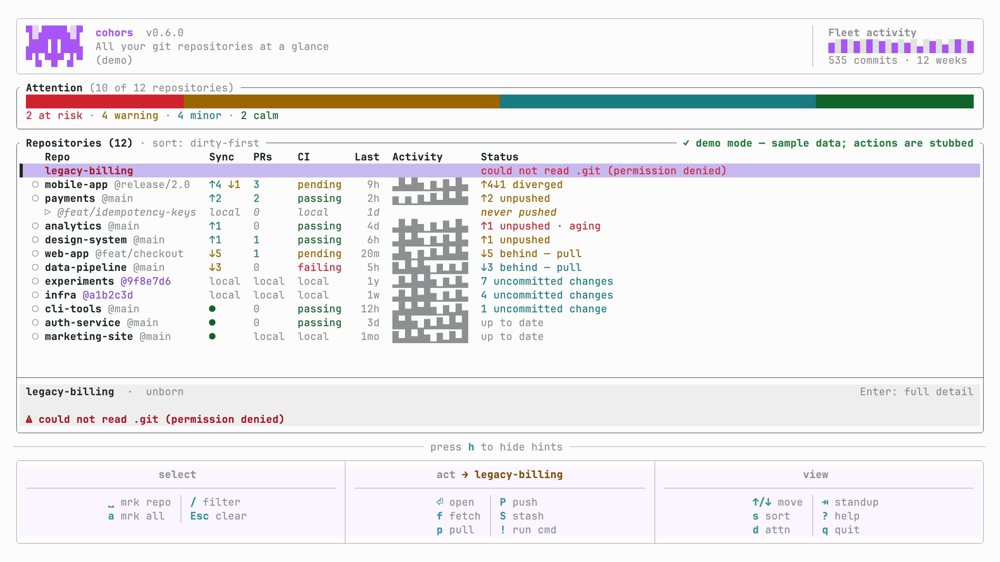
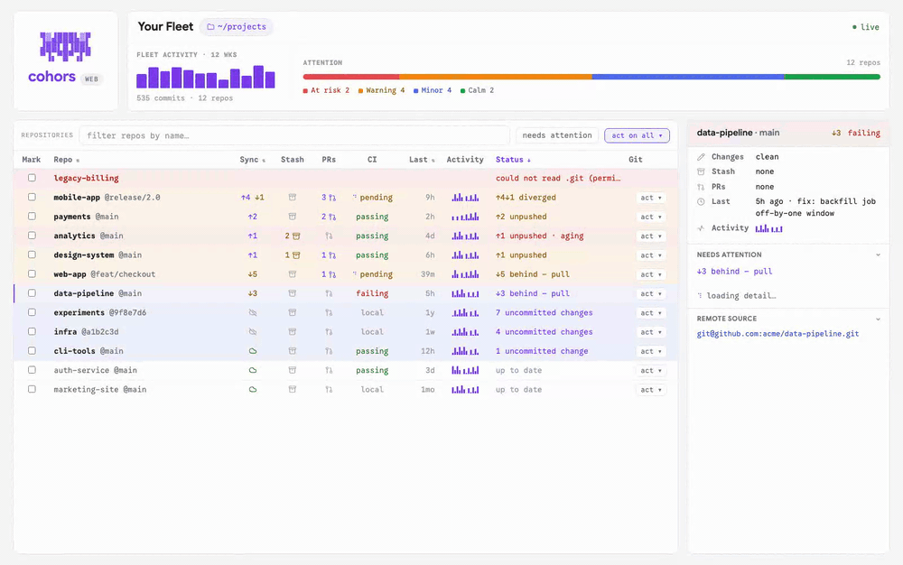

<div align="center">

# cohors

**A governed control plane for all your git repositories: for you, and your coding agent.**

Coding agents made single-repo work cheap. The bottleneck moved to the *fleet*: an agent is blind across your 20 repos. It can't see which need attention, can't find which ones call `X`, and can't safely act across them. cohors is the fix: one fast view of every repo, a search that indexes the whole fleet, and bulk actions an agent can preview before you ever grant write access. Over MCP, in the terminal, and in the browser. One Rust core.

<sub><i>cohors</i> is Latin for "cohort," a Roman legion's core unit. Every repository, marshalled into one cohort under your command.</sub>

[](https://github.com/rushirb2001/cohors/actions/workflows/ci.yml)
[](https://github.com/rushirb2001/cohors/releases)
[](LICENSE)
[](https://www.rust-lang.org/)

</div>

<div align="center">



</div>

---

## The fleet is the new bottleneck

You, and your agent, now work across dozens of repos, and the hard questions are fleet-wide: *Which repos have uncommitted work? Which still import the old client? Run the tests in everything I touched today. Rename this header everywhere and open a PR in each.*

By hand that's `cd … && git status` across a dozen tabs and a `for d in */` loop with no guard rail. And handing that loop to an agent means trusting it with **unbounded mutation across your whole machine**. cohors makes the fleet a first-class thing you can **enumerate, search, and act on, safely.**

## For your agent: a governed MCP control plane

`cohors mcp` gives a coding agent the same fleet sense you have, behind a safety model you control. The workflow it unlocks is **find → target → preview → act**:

```text
search("X-Tenant-Id", kind=content)      →  the 3 repos that still use it
run("<codemod>", {ids:[…]}, dry_run)     →  "would run in 3 repos"  (nothing touched)
#  …you approve the plan, then:
run("<codemod>", {ids:[…]}, confirm)     →  per-repo { ok, exit_code, stdout, … }
```

Register it. It's **read-only by default**; opt into actions with flags:

```sh
claude mcp add cohors -- "$(which cohors)" mcp                              # read-only
claude mcp add cohors -- "$(which cohors)" mcp --allow-writes --allow-run   # + bulk actions
```

Use the **absolute path**: an agent spawns the server with a stripped `PATH`, so a bare `cohors mcp` often resolves to nothing and the agent silently ends up with no tools. For any other client (Claude Desktop, Cursor, Zed, …), the same command and args go in its `mcpServers` block. Run `cohors mcp` by hand and it prints both lines, already filled in with your install path.

**Why an MCP and not a bash loop?** The value isn't capability: an agent *can* loop over `git`. It's the **governed boundary**, which an agent cannot give itself:

- Read-only unless you launch it armed; `pull` is fast-forward-only (it can't lose work).
- `confirm` on destructive actions; `dry_run` previews the blast radius with zero side effects (even on a read-only server).
- Scope-locked to your configured roots; an empty selector matches **nothing**, so a fumbled argument can't fan out across everything.
- A target cap, an optional `run` command allowlist, and an audit log of every action.

**Tools.** Reads (always on): `list_repos`, `get_repo`, `fleet_summary`, `search`, `changes`, `repo_path`, `list_prs`, `ci_status`. Actions (flag-gated): `fetch`, `pull`, `push`, `commit`, `stash`, `run`. Every read carries diagnostics (the roots searched, the config in effect), so an empty fleet explains itself instead of reading as "all clear."

## For you: a fast fleet dashboard

The same core powers a terminal dashboard. See it in five seconds, no setup, nothing written to disk:

```sh
cohors demo
```

- **Every repo on one screen**: branch, ahead/behind, dirty state, stashes, last activity, sorted dirty-first.
- **Per-branch rows**: a repo with several local branches expands into one row each, carrying its own CI, ahead/behind, and status. Checks are keyed by ref, not by what happens to be checked out, so each branch reports its own truth.
- **Fast**: parallel scanning with a warm cache; launches in milliseconds across dozens of repos.
- **Bulk actions**: fetch, pull (ff-only), push, commit, stash (confirmed), and run a command across the selected repos with live, per-repo output.
- **Remote-aware**: open pull-request counts (on the branch each PR targets), CI status, and ahead/behind vs upstream, inline.
- **Weekly standup**: every commit you made this week, across every repo, in one view.

## For your team: the same fleet in the browser

`cohors web` serves that **same scan** in the browser: local status (worktree, ahead/behind, stash, *why each repo needs you*) plus remote CI/PRs, rendered through the **same core** the TUI and MCP use, so all three surfaces agree by construction. The GitHub token stays on your machine; the page never sees it. Point it at one folder with `--root`, and `--watch` keeps it live. Try it instantly with `cohors web --demo` (sample data, nothing on disk). (A hosted, shareable read-only dashboard is on the roadmap.)

<div align="center">



</div>

## Install

No Rust needed, just `git` on your `PATH`. Every channel installs the same prebuilt binary from the [latest release](https://github.com/rushirb2001/cohors/releases/latest).

**Homebrew** (macOS / Linux):

```sh
brew install rushirb2001/tap/cohors
```

> If your Homebrew enforces tap-trust (newer versions), the install can silently no-op. Trust the formula once, then install:
> ```sh
> brew trust --formula rushirb2001/tap/cohors
> brew install rushirb2001/tap/cohors
> ```

**pip** (macOS Apple Silicon / Intel, Linux x86_64; installs a prebuilt binary, no Rust):

```sh
pip install cohors
```

**Shell one-liner** (checksum-verified):

```sh
curl --proto '=https' --tlsv1.2 -LsSf https://github.com/rushirb2001/cohors/releases/latest/download/cohors-tui-installer.sh | sh
```

**From source** (requires [Rust](https://rustup.rs)):

```sh
cargo install --git https://github.com/rushirb2001/cohors cohors-tui   # the `cohors` binary
```

Then just run it:

```sh
cohors
```

With no config, cohors auto-detects the folders where you keep code and shows every repo it finds: your whole **super fleet**. Scope the dashboard to one folder with `cohors --root ~/code`, or run `cohors init` to save an editable config (aliases, groups, ignore rules).

crates.io distribution is planned.

## Usage

```sh
cohors                     # auto-detect every repo and launch the dashboard (the super fleet)
cohors --root ~/code       # scope the dashboard to a single folder
cohors demo                # full UI on built-in sample data (nothing written to disk)
cohors init                # save an editable config to ~/.config/cohors/config.toml
cohors scan                # a report of what needs you, grouped by urgency (JSON when piped)
cohors scan --select dirty # filter: e.g. dirty, behind, 'name:pay*', or raw JSON
cohors fetch --select all --dry-run   # preview any bulk action before it touches anything
cohors mcp                 # run the MCP server (read-only; --allow-writes / --allow-run to arm)
cohors web                 # serve the same fleet in the browser (--root to scope, --watch for live)
cohors web --demo          # browser UI on built-in sample data (nothing scanned)
```

Inside the dashboard: `↑`/`↓` move · `Enter` inspect · `/` fuzzy filter · `:` command palette · `Space` mark · `f`/`p`/`P`/`S` fetch/pull/push/stash · `!` run a command · `Tab` weekly standup · `?` help · `q` quit. Bulk actions target the marked repos, or the current one when nothing is marked. On a repo with several branches, `P` asks which one to push.

Every command surface introduces itself: run an action without a selector and it prints what it does, its safety posture, and how to pick repos rather than erroring at you. Nothing writes without a selector, and every action takes `--dry-run`.

## How it compares

| | cohors | git-scope | mani / gita | lazygit / gitui |
|---|:---:|:---:|:---:|:---:|
| Multi-repository overview | Yes | Yes | Text only | No |
| Polished terminal UI | Yes | Yes | No | Yes |
| Bulk actions (fetch / pull / run) | Yes | Read-only | Yes | No |
| Remote / PR / CI awareness | Yes | No | No | Single repo |
| Cross-repo search + weekly standup | Yes | No | No | No |
| **Agent control plane (MCP)** | **Yes** | No | No | No |
| Language | Rust | Go | Go / Python | Go / Rust |

## How it's built

A Rust workspace around a pure, I/O-free core with thin adapters, so the *same* analysis powers the terminal, the agent, and the browser:

- `cohors-core`: pure, WASM-safe models and analysis (attention scoring, the selector language and its shorthand parser, search).
- `cohors-config` · `cohors-git` ([gitoxide](https://github.com/GitoxideLabs/gitoxide)) · `cohors-github`: config, local git (bare repos included, history-memoized rescans), and GitHub (parallel, rate-limit-aware) adapters.
- `cohors-actions`: the write layer, holding the git action primitives, the one action registry every surface wires from, and the `dispatch()` the machine surfaces share.
- `cohors-fleet`: the composition layer, with one `Scanner` (config + git + github wired once) and the read facade every front-end goes through, enforced by tests rather than convention.
- `cohors-mcp`: the MCP server (hand-rolled JSON-RPC over stdio), launched by `cohors mcp`.
- `cohors-tui` ([ratatui](https://ratatui.rs)): the `cohors` binary (dashboard and CLI).
- `cohors-web` ([Leptos](https://leptos.dev), WASM): the browser front-end plus the native `cohors web` server (which can also run gated bulk actions via `POST /api/action`).

Because the core is independent of its data sources and front-ends, one selector language, one analysis, and one action registry serve every surface, and structural tests fail the build if any surface drifts.

## Contributing

Contributions are welcome. See [CONTRIBUTING.md](CONTRIBUTING.md) for the development setup, quality gates, and conventions.

## License

Released under the [MIT License](LICENSE).
