<div align="center">

<picture>
  <source media="(prefers-color-scheme: dark)" srcset="assets/readme/cohors-dark.png">
  
</picture>

### Every git repo you own, on one screen.

What's unpushed, what's behind, and what to do next, across every repository on your machine.

[](https://github.com/rushirb2001/cohors/actions/workflows/ci.yml)
[](https://github.com/rushirb2001/cohors/releases)
[%22&replace=%241&label=homebrew&color=FBB040)](https://github.com/rushirb2001/homebrew-tap)
[](https://pypi.org/project/cohors/)
[](https://www.npmjs.com/package/@cohors/cli)
[](https://crates.io/crates/cohors)
[](LICENSE)
[](https://www.rust-lang.org/)

<kbd>&nbsp;[Install](#install)&nbsp;</kbd>&ensp;
<kbd>&nbsp;[Terminal](#use-it-in-the-terminal)&nbsp;</kbd>&ensp;
<kbd>&nbsp;[Claude Code](#use-it-with-claude-code)&nbsp;</kbd>&ensp;
<kbd>&nbsp;[Scripts](#use-it-from-scripts)&nbsp;</kbd>&ensp;
<kbd>&nbsp;[VS Code & browser](#use-it-in-vs-code-and-the-browser)&nbsp;</kbd>&ensp;
<kbd>&nbsp;[Launchpad](#the-launchpad)&nbsp;</kbd>


</div>

## Install

**Homebrew**
```sh
brew install rushirb2001/tap/cohors
```

**pip**
```sh
pip install cohors
```

**npm**
```sh
npm install -g @cohors/cli
```

**Cargo**
```sh
cargo install cohors
```

**Shell installer**
```sh
curl -LsSf https://github.com/rushirb2001/cohors/releases/latest/download/cohors-installer.sh | sh
```

**Run once, without installing**
```sh
uvx cohors@latest
```
```sh
npx @cohors/cli@latest
```

Then run `cohors`. To try it on sample repositories first, run `cohors demo`.

Prebuilt for macOS and Linux; Cargo builds it anywhere Rust runs. All it needs is `git`. The examples below are real output from the `cohors demo` sample fleet, trimmed where marked `…`.

## What it answers

<br>

<picture>
  <source media="(prefers-color-scheme: dark)" srcset="https://raw.githubusercontent.com/rushirb2001/cohors/main/assets/readme/answers-dark.svg">
  <source media="(prefers-color-scheme: light)" srcset="https://raw.githubusercontent.com/rushirb2001/cohors/main/assets/readme/answers-light.svg">
  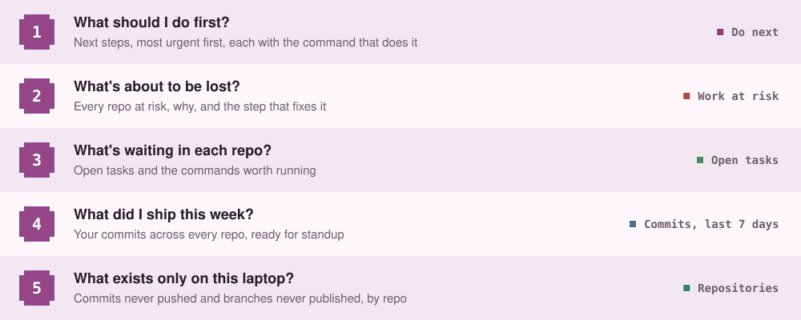
</picture>

<br>

**Where it looks.** With no config, the folders where code usually lives. Point it at yours with `cohors --root ~/code` (repeat for more), or save them with `cohors init`, which writes `~/.config/cohors/config.toml` for roots, aliases, groups and ignore rules.

## Use it in the terminal

```sh
cohors
```


**Do next** lists what to do, most urgent first. Press a step's letter to act on every repo in it, or mark repos with <kbd>Space</kbd> and press the letter yourself.

<br>

<picture>
  <source media="(prefers-color-scheme: dark)" srcset="https://raw.githubusercontent.com/rushirb2001/cohors/main/assets/readme/keys-dark.svg">
  <source media="(prefers-color-scheme: light)" srcset="https://raw.githubusercontent.com/rushirb2001/cohors/main/assets/readme/keys-light.svg">
  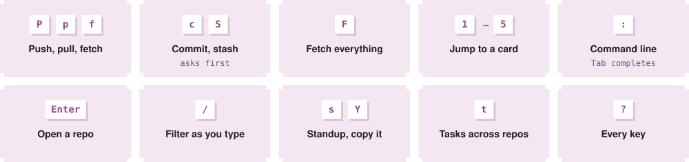
</picture>

<br>

From the <kbd>:</kbd> line: `:commit wip: cart drawer` commits the marked repos, `:!npm test` runs a command in them, `:jump payments` goes to one. `cohors --watch` keeps it all live.

<a name="use-it-with-claude-code"></a>

##  Use it with Claude Code

```text
/plugin marketplace add rushirb2001/cohors
```
```text
/plugin install cohors@cohors
```

Ask *"what needs my attention across my repos?"* and Claude gets the whole fleet in one call:

<br>

<picture>
  <source media="(prefers-color-scheme: dark)" srcset="https://raw.githubusercontent.com/rushirb2001/cohors/main/assets/readme/claude-dark.svg">
  <source media="(prefers-color-scheme: light)" srcset="https://raw.githubusercontent.com/rushirb2001/cohors/main/assets/readme/claude-light.svg">
  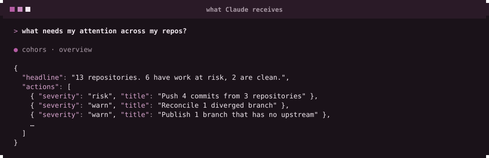
</picture>

<br>

More to ask:

<br>

<picture>
  <source media="(prefers-color-scheme: dark)" srcset="https://raw.githubusercontent.com/rushirb2001/cohors/main/assets/readme/ask-dark.svg">
  <source media="(prefers-color-scheme: light)" srcset="https://raw.githubusercontent.com/rushirb2001/cohors/main/assets/readme/ask-light.svg">
  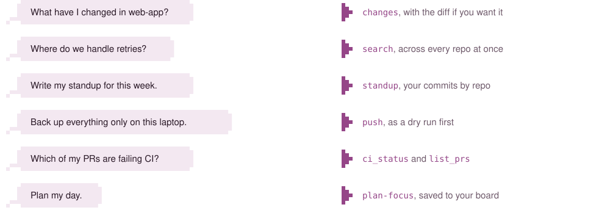
</picture>

<br>

It starts **read-only**. Turn on what Claude may do with `claude plugin configure cohors@cohors`, then start a new session:

<br>

<picture>
  <source media="(prefers-color-scheme: dark)" srcset="https://raw.githubusercontent.com/rushirb2001/cohors/main/assets/readme/permissions-dark.svg">
  <source media="(prefers-color-scheme: light)" srcset="https://raw.githubusercontent.com/rushirb2001/cohors/main/assets/readme/permissions-light.svg">
  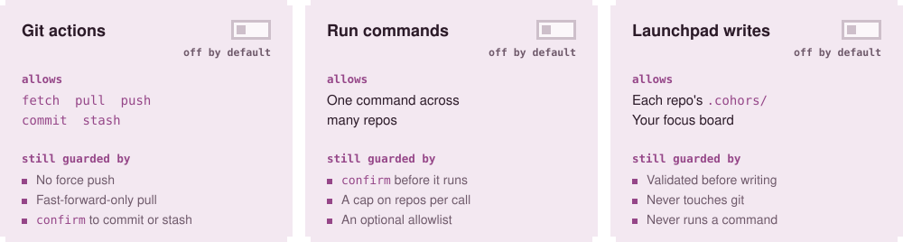
</picture>

<br>

Or let cohors brief Claude for you: `cohors agent run plan-day`, or `cohors agent run task --repo payments --task idempotency-keys` to start on one task (run it again to resume the same conversation).

<details>
<summary>Other MCP clients</summary>
<br>

```json
{ "command": "uvx", "args": ["cohors@latest", "mcp"] }
{ "command": "npx", "args": ["-y", "@cohors/cli@latest", "mcp"] }
```

Or with cohors installed: `claude mcp add cohors -- "$(which cohors)" mcp`, adding `--allow-writes`, `--allow-run` or `--allow-launchpad`. Listed in the [MCP Registry](https://registry.modelcontextprotocol.io/v0/servers?search=io.github.rushirb2001/cohors) as `io.github.rushirb2001/cohors`.

</details>

## Use it from scripts

Every view is a command. At a terminal it prints a report; piped, it prints JSON.

<br>

<picture>
  <source media="(prefers-color-scheme: dark)" srcset="https://raw.githubusercontent.com/rushirb2001/cohors/main/assets/readme/scripts-dark.svg">
  <source media="(prefers-color-scheme: light)" srcset="https://raw.githubusercontent.com/rushirb2001/cohors/main/assets/readme/scripts-light.svg">
  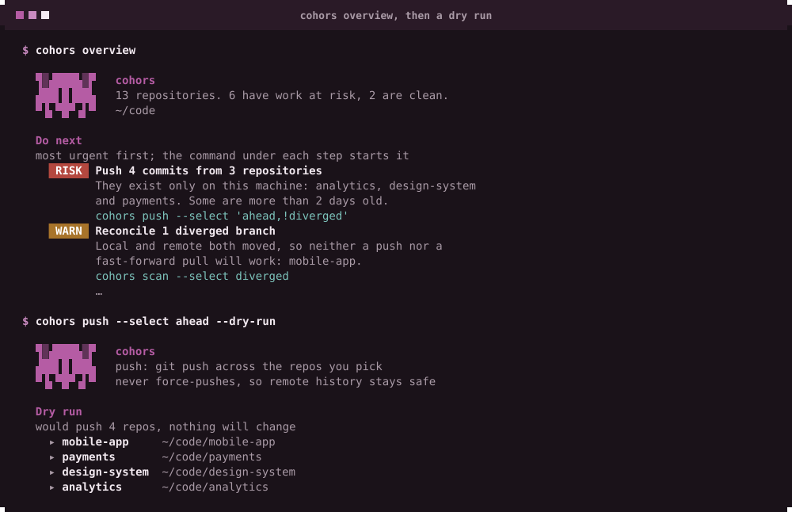
</picture>

<br>

`--select` picks the repos. Join terms with a comma (all must match) and put `!` in front to exclude:

<br>

<picture>
  <source media="(prefers-color-scheme: dark)" srcset="https://raw.githubusercontent.com/rushirb2001/cohors/main/assets/readme/select-dark.svg">
  <source media="(prefers-color-scheme: light)" srcset="https://raw.githubusercontent.com/rushirb2001/cohors/main/assets/readme/select-light.svg">
  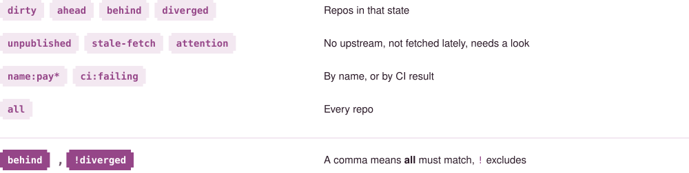
</picture>

<br>

```sh
cohors fetch --select all                      # refresh every remote
cohors run --select 'name:web-*' 'npm test'    # one command, many repos
cohors standup                                 # this week's commits, as Markdown
cohors overview --json | jq -r '.actions[].title'
```

## Use it in VS Code and the browser

<br>

<table>
<tr>
<td width="50%"></td>
<td width="50%"></td>
</tr>
<tr>
<td valign="top">

The cohors icon in the activity bar shows the fleet as native panes. Push, pull and fetch from any step, run a repo's commands in a terminal, or start Claude on a task.

[](https://marketplace.visualstudio.com/items?itemName=rushirb2001.cohors)
[](https://open-vsx.org/extension/rushirb2001/cohors)

Search **cohors** in the Extensions view. Cursor, Windsurf and VSCodium install it from Open VSX.

</td>
<td valign="top">

`cohors web --root ~/code --watch` serves the dashboard on localhost, with pull requests and CI. Read-only unless you add `--allow-writes`. `cohors web --demo` shows the sample fleet.

</td>
</tr>
</table>

<br>

## The launchpad

A repo can commit one small file saying what to run there and what's in progress, so it travels with every clone:

<br>

<picture>
  <source media="(prefers-color-scheme: dark)" srcset="https://raw.githubusercontent.com/rushirb2001/cohors/main/assets/readme/tree-dark.svg">
  <source media="(prefers-color-scheme: light)" srcset="https://raw.githubusercontent.com/rushirb2001/cohors/main/assets/readme/tree-light.svg">
  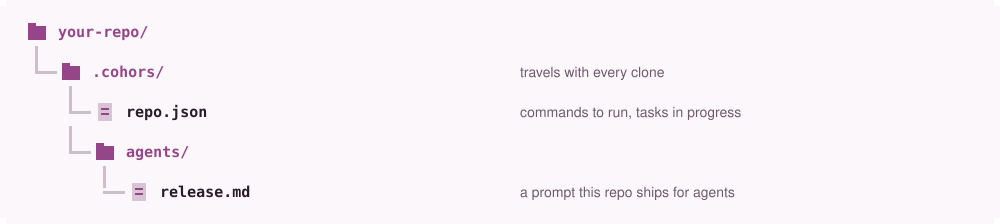
</picture>

<br>

Ask Claude to *set up this repo for the launchpad* and it writes the file. Commands from npm, Cargo, uv, Makefiles and Gradle are found without one.

<br>

<picture>
  <source media="(prefers-color-scheme: dark)" srcset="https://raw.githubusercontent.com/rushirb2001/cohors/main/assets/readme/launchpad-dark.svg">
  <source media="(prefers-color-scheme: light)" srcset="https://raw.githubusercontent.com/rushirb2001/cohors/main/assets/readme/launchpad-light.svg">
  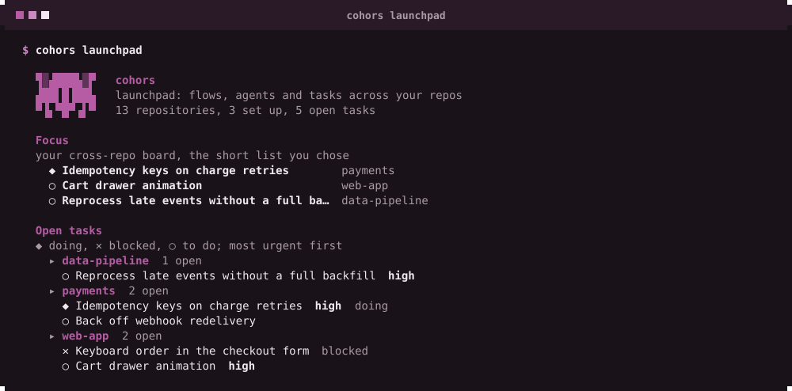
</picture>

<br>

Check a file with `cohors launchpad validate .`. The format is an open spec: [spec/v1/SPEC.md](spec/v1/SPEC.md).

## Safe by default

- `pull` is fast-forward only, and nothing force-pushes.
- No action runs without `--select`, and every one takes `--dry-run`.
- No single key can destroy work. Commit and stash ask first.
- The MCP server and the browser dashboard start read-only.
- One unreadable repo is reported, never fatal.
- No account, no telemetry. It talks only to GitHub. See the [privacy policy](PRIVACY.md).

## Staying up to date

Once a day cohors checks for a release. Installed with Homebrew, pip or the shell installer, it updates itself in the background and shows **Restart to update**; press <kbd>R</kbd>. `cohors update` does it now. Set `updates = "notify"` or `"off"` in the config to change that.

<details>
<summary>Updating by hand</summary>

<br>

<picture>
  <source media="(prefers-color-scheme: dark)" srcset="https://raw.githubusercontent.com/rushirb2001/cohors/main/assets/readme/update-dark.svg">
  <source media="(prefers-color-scheme: light)" srcset="https://raw.githubusercontent.com/rushirb2001/cohors/main/assets/readme/update-light.svg">
  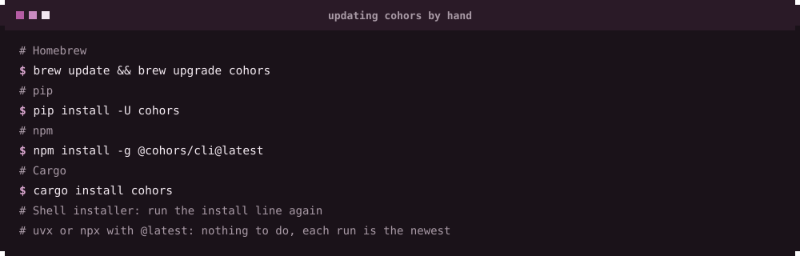
</picture>

<br>

</details>

## How it compares

<br>

<picture>
  <source media="(prefers-color-scheme: dark)" srcset="https://raw.githubusercontent.com/rushirb2001/cohors/main/assets/readme/compare-dark.svg">
  <source media="(prefers-color-scheme: light)" srcset="https://raw.githubusercontent.com/rushirb2001/cohors/main/assets/readme/compare-light.svg">
  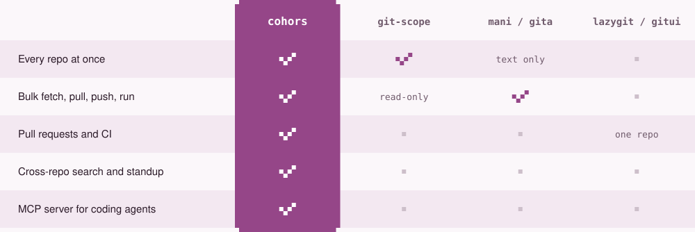
</picture>

<br>

<div align="center">
<br>

[Contributing](CONTRIBUTING.md) &ensp;·&ensp; [Changelog](CHANGELOG.md) &ensp;·&ensp; [Privacy](PRIVACY.md) &ensp;·&ensp; [MIT License](LICENSE)

<sub><i>cohors</i> is Latin for "cohort": every repository, marshalled under one command.</sub>

</div>
