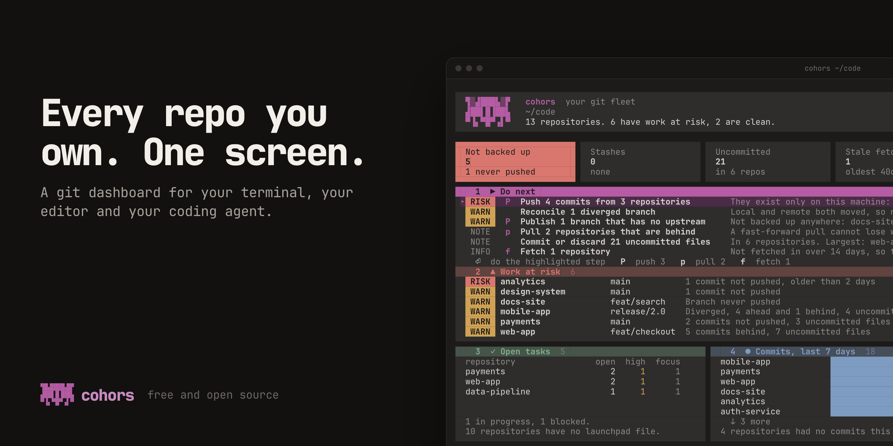

<div align="center">

# cohors

**Every repo you own, on one screen: in your terminal, your editor and your coding agent.**

[](https://github.com/rushirb2001/cohors/actions/workflows/ci.yml)
[](https://github.com/rushirb2001/cohors/releases)
[](LICENSE)
[](https://www.rust-lang.org/)



</div>

cohors reads every git repository on your machine and tells you what state your work is in and what to do about it. One Rust binary serves a terminal dashboard, a VS Code extension, a browser dashboard and an MCP server for your coding agent, all drawn from the same analysis, so they always agree.

<sub><i>cohors</i> is Latin for "cohort," a Roman legion's core unit: every repository, marshalled under one command.</sub>

## One key, and four repositories are backed up


That is a real run, on real repositories with real remotes. The dashboard found five repositories holding work that was on no remote and listed backing them up as the first thing to do. One key pushed the four that could simply be pushed; the fifth has diverged from its remote, so cohors leaves that decision to you. Try the same screen on sample data, with nothing written to disk:

```sh
cohors demo
```

## Five questions a pile of terminals cannot answer

| | |
|---|---|
| **What only exists on this laptop?** | Commits never pushed and branches never published, counted and named. |
| **What should I do first?** | A short list of steps, most urgent first: push, publish, pull, review. |
| **Where is work about to be lost?** | Every repository at risk, with the reason and the step that fixes it. |
| **What did I ship this week?** | Your commits across every repository, ready to paste into a standup. |
| **What is waiting in each repo?** | Open tasks and the commands to run, written down in the repo itself. |

## The same fleet, three places

**In the terminal.** Five cards on one screen, each in its own colour: what to do next, work at risk, open tasks, the week's commits, and every repository. A letter is one verb everywhere: `f` fetches, `p` pulls, `P` pushes, `c` commits, `S` stashes.


**In VS Code.** The cohors icon in the activity bar opens the overview as six native panes; the dashboard tab has the same cards, with a detail panel for each repository. It reads everything from the `cohors` binary.


**In the browser.** `cohors web` serves the same scan on localhost, read-only unless you start it with write access. Your GitHub token stays on your machine; the page never sees it.


## For your agent: a governed MCP control plane

`cohors mcp` gives a coding agent the same fleet sense you have, behind a safety model you control. The workflow it unlocks is **find → target → preview → act**:

```text
search("X-Tenant-Id", kind=content)      →  the 3 repos that still use it
run("<codemod>", {ids:[…]}, dry_run)     →  "would run in 3 repos"  (nothing touched)
#  …you approve the plan, then:
run("<codemod>", {ids:[…]}, confirm)     →  per-repo { ok, exit_code, stdout, … }
```

**In Claude Code, install the plugin.** It registers the server for you, finds the binary wherever your install put it, and adds skills for fleet work, setting a repo up, and planning your focus:

```text
/plugin install cohors --marketplace rushirb2001/cohors
```

Or register the server by hand. It's **read-only by default**; opt into actions with flags:

```sh
claude mcp add cohors -- "$(which cohors)" mcp                              # read-only
claude mcp add cohors -- "$(which cohors)" mcp --allow-writes --allow-run   # + bulk actions
claude mcp add cohors -- "$(which cohors)" mcp --allow-launchpad            # + launchpad writes
```

When registering by hand, use the **absolute path**: an agent spawns the server with a stripped `PATH`, so a bare `cohors mcp` often resolves to nothing and the agent silently ends up with no tools. For any other client (Claude Desktop, Cursor, Zed, …), the same command and args go in its `mcpServers` block. Run `cohors mcp` by hand and it prints both lines, already filled in with your install path.

**Why an MCP and not a bash loop?** The value isn't capability: an agent *can* loop over `git`. It's the **governed boundary**, which an agent cannot give itself:

- Read-only unless you launch it armed; `pull` is fast-forward-only (it can't lose work).
- `confirm` on destructive actions; `dry_run` previews the blast radius with zero side effects (even on a read-only server).
- Scope-locked to your configured roots; an empty selector matches **nothing**, so a fumbled argument can't fan out across everything.
- A target cap, an optional `run` command allowlist, and an audit log of every action.

**Tools.** Reads (always on): `list_repos`, `get_repo`, `fleet_summary`, `search`, `changes`, `repo_path`, `list_prs`, `ci_status`, plus the launchpad reads `launchpad`, `read_contract`, `read_board`. Actions (flag-gated): `fetch`, `pull`, `push`, `commit`, `stash`, `run`. Launchpad writes (`--allow-launchpad`): `write_repo_contribution`, `write_board`, `record_activity`. Every read carries diagnostics (the roots searched, the config in effect), so an empty fleet explains itself instead of reading as "all clear."

## The launchpad: what each repo offers, and what is waiting in it

Status tells you what state a repo is in. The launchpad tells you what you can *do* there. A repository opts in by committing one small file, so its entry travels with the clone:

```text
your-repo/.cohors/
├── repo.json          # flows to run, agents it ships, short-lived tasks
└── agents/release.md  # a prompt this repo ships for recurring work
```

You don't write it. In that repo, ask your agent to **"set up this repo for the launchpad"**; it reads the code and writes the file, and cohors rejects anything invalid with the full list of problems. Flows from npm, cargo, uv, Makefile, and gradle are detected with no file at all.

```sh
cohors launchpad              # your focus board + every open task across the fleet
cohors launchpad validate .   # check this repo's .cohors/repo.json
```

Then ask your agent to **"plan my day"**: it reads every repo's tasks, the uncommitted and unpushed work nobody wrote a task for, and failing CI, and proposes a cross-repo focus board.

The format is an open contract, written down in [spec/v1/SPEC.md](spec/v1/SPEC.md). Text inside a repo's launchpad files is treated as untrusted data: the agent is told so, and cohors never runs a declared flow on its own.

## Install

No Rust needed, just `git` on your `PATH`. Every channel installs the same prebuilt binary from the [latest release](https://github.com/rushirb2001/cohors/releases/latest).

**Homebrew** (macOS / Linux):

```sh
brew install rushirb2001/tap/cohors
```

> If your Homebrew enforces tap-trust (newer versions), the install can silently no-op. Trust the formula once, then install:
> ```sh
> brew trust --formula rushirb2001/tap/cohors
> brew install rushirb2001/tap/cohors
> ```

**pip** (macOS Apple Silicon / Intel, Linux x86_64 / ARM64; installs a prebuilt binary, no Rust):

```sh
pip install cohors
```

**Shell one-liner** (checksum-verified):

```sh
curl --proto '=https' --tlsv1.2 -LsSf https://github.com/rushirb2001/cohors/releases/latest/download/cohors-tui-installer.sh | sh
```

**From source** (requires [Rust](https://rustup.rs)):

```sh
cargo install --git https://github.com/rushirb2001/cohors cohors-tui   # the `cohors` binary
```

Then just run it:

```sh
cohors
```

With no config, cohors looks in the folders where code usually lives and shows every repository it finds. Scope it to one folder with `cohors --root ~/code`, or run `cohors init` to save an editable config (roots, aliases, groups, ignore rules).

**The VS Code extension** is built from this repository until it is on the Marketplace:

```sh
python3 scripts/package-extension.py
code --install-extension target/extension/cohors-*.vsix
```

crates.io distribution is planned.

## Usage

```sh
cohors                     # find every repo and open the dashboard
cohors --root ~/code       # scope it to one folder
cohors demo                # the whole dashboard on sample data (nothing written to disk)
cohors init                # save an editable config to ~/.config/cohors/config.toml
cohors overview            # what to do next across every repo, and why (JSON when piped)
cohors scan                # what needs you, grouped by urgency
cohors scan --select dirty # filter: dirty, behind, unpublished, 'name:pay*', or raw JSON
cohors standup             # your commits across every repo, ready to paste
cohors fetch --select all --dry-run   # preview any bulk action before it touches anything
cohors launchpad           # focus board + open tasks across the fleet
cohors agent run setup-repo --repo .  # start your coding agent on a repo, with a shipped prompt
cohors mcp                 # the MCP server (read-only; --allow-writes / --allow-run to arm)
cohors web                 # the same fleet in the browser (--root to scope, --watch for live)
```

Inside the dashboard: `1`-`5` focus a card · `Tab` next card · `↑`/`↓` move · `Enter` open · `/` filter · `:` command line (Tab completes, `↑` recalls) · `Space` mark · `f`/`p`/`P`/`c`/`S` fetch, pull, push, commit, stash · `s` standup · `t` tasks · `F` fetch everything · `?` help · `q` quit. On "Do next" the letters carry out a step for all its repositories; on a repository they act on that one, or on the ones you marked.

Every command introduces itself: run an action without a selector and it prints what it does, how safe it is, and how to pick repositories, rather than erroring at you. Nothing writes without a selector, and every action takes `--dry-run`. `pull` is fast-forward only and nothing ever force-pushes.

## How it compares

| | cohors | git-scope | mani / gita | lazygit / gitui |
|---|:---:|:---:|:---:|:---:|
| Multi-repository overview | Yes | Yes | Text only | No |
| Polished terminal UI | Yes | Yes | No | Yes |
| Bulk actions (fetch / pull / run) | Yes | Read-only | Yes | No |
| Remote / PR / CI awareness | Yes | No | No | Single repo |
| Cross-repo search + weekly standup | Yes | No | No | No |
| **Agent control plane (MCP)** | **Yes** | No | No | No |
| Per-repo tasks, flows, and a focus board | Yes | No | Tasks via config | No |
| Language | Rust | Go | Go / Python | Go / Rust |

## How it's built

A Rust workspace around a pure, I/O-free core with thin adapters, so the *same* analysis powers the terminal, the agent, and the browser:

- `cohors-core`: pure, WASM-safe models and analysis (attention scoring, the selector language and its shorthand parser, search, the launchpad contract).
- `cohors-config` · `cohors-git` ([gitoxide](https://github.com/GitoxideLabs/gitoxide)) · `cohors-github`: config, local git (bare repos included, history-memoized rescans), and GitHub (parallel, rate-limit-aware) adapters.
- `cohors-actions`: the write layer, holding the git action primitives, the one action registry every surface wires from, and the `dispatch()` the machine surfaces share.
- `cohors-launchpad`: the launchpad adapter, which reads each repo's `.cohors/` contribution and does validated, symlink-safe writes of contributions, the focus board, and the activity log.
- `cohors-fleet`: the composition layer, with one `Scanner` (config + git + github wired once) and the read facade every front-end goes through, enforced by tests rather than convention.
- `cohors-mcp`: the MCP server (hand-rolled JSON-RPC over stdio), launched by `cohors mcp`.
- `cohors-tui` ([ratatui](https://ratatui.rs)): the `cohors` binary (dashboard and CLI).
- `extension/`: the VS Code extension, plain JavaScript with no dependencies, which shells out to the binary.
- `cohors-web` ([Leptos](https://leptos.dev), WASM): the browser front-end plus the native `cohors web` server (which can also run gated bulk actions via `POST /api/action`).

Because the core is independent of its data sources and front-ends, one selector language, one analysis, and one action registry serve every surface, and structural tests fail the build if any surface drifts.

## Contributing

Contributions are welcome. See [CONTRIBUTING.md](CONTRIBUTING.md) for the development setup, quality gates, and conventions.

## License

Released under the [MIT License](LICENSE).
