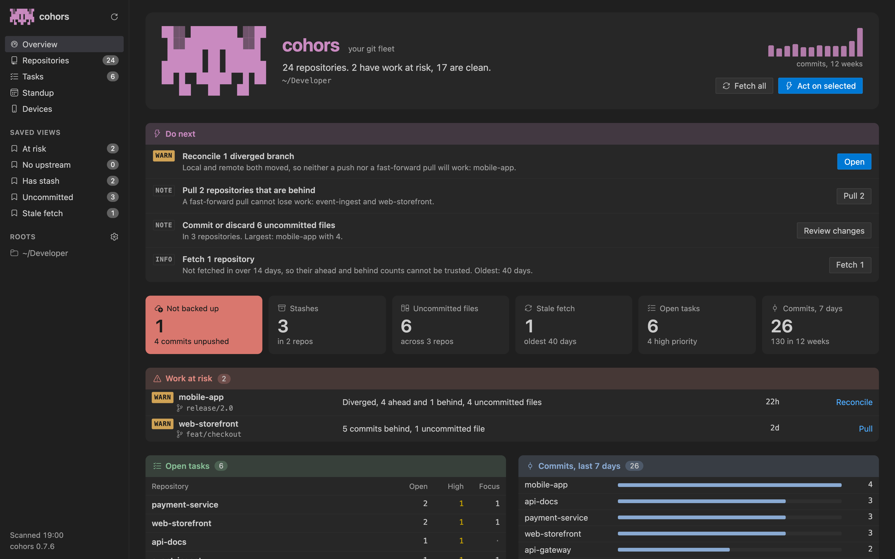
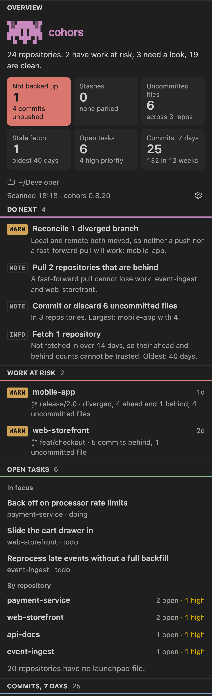

# cohors for VS Code

**Every git repo you own, in your editor's sidebar.** What's unpushed, what's behind, what's about to be lost, and what to do next, across every repository on your machine, without leaving the editor. Works in VS Code, and from Open VSX in Cursor, Windsurf and VSCodium.



## Set up

**1. Install the `cohors` command-line tool.** The extension shows what it reads, so it comes first. Any one of:

```sh
brew install rushirb2001/tap/cohors
pip install cohors
npm install -g @cohors/cli
cargo install cohors
```

It runs on macOS and Linux and needs `git`.

**2. Install the extension.** Search **cohors** in the Extensions view, or:

```sh
code --install-extension rushirb2001.cohors
```

**3. Click the cohors icon in the activity bar.** If it can't find `cohors`, run **cohors: How to install the cohors command-line tool**, or set `cohors.binaryPath`.

The editor keeps the extension up to date. The command-line tool updates itself when it came from Homebrew, pip or the shell installer; from npm or Cargo it tells you when a release is out.

## What you get

- **The fleet in the sidebar**: what to do next, work at risk, open tasks, this week's commits and every repository, as native panes.
- **The full dashboard in a tab**: **cohors: Open dashboard** (<kbd>Cmd</kbd>+<kbd>Alt</kbd>+<kbd>L</kbd>, or <kbd>Ctrl</kbd>+<kbd>Alt</kbd>+<kbd>L</kbd>).
- **Act from where you are**: push, pull or fetch any step or repository, open it in a new window, or open a terminal there. Pull, push, commit and stash ask first and offer a dry-run preview, and every action runs in a terminal so you see exactly what happens.
- **Run a repo's commands**: the commands a repository declares (or that cohors detects from npm, Cargo, uv, Makefiles and Gradle) run in a VS Code terminal with one click.
- **Start an agent on a task**: each task has a button that opens Claude Code (or Codex, Gemini CLI or agy) in a terminal, briefed on that task. Run it again and it resumes the same conversation.



## Settings

| Setting | Default | |
|---|---|---|
| `cohors.roots` | `[]` | Folders to scan. Empty uses the roots in your cohors config. **cohors: Use this workspace's folders as roots** fills it in. |
| `cohors.binaryPath` | `""` | Absolute path to `cohors`, when it isn't on your login shell's `PATH`. Machine-wide only. |
| `cohors.refreshSeconds` | `30` | Seconds between refreshes while the dashboard tab is focused; `0` turns polling off. File changes in the open workspace refresh it straight away. |
| `cohors.openOnStartup` | `off` | What opens with a window: `off`, `sidebar`, `dashboard` or `both`. |

For example, in your user `settings.json`:

```json
{
  "cohors.roots": ["~/code", "~/work"],
  "cohors.openOnStartup": "sidebar"
}
```

## Commands

| Command | Does |
|---|---|
| cohors: Open dashboard | The full dashboard in a tab |
| cohors: Refresh | Scan again now |
| cohors: Fetch every repository | `git fetch` everywhere |
| cohors: Set up this repo with an agent | Your agent writes this repo's launchpad file |
| cohors: Plan my day with an agent | Your agent plans your focus across every repo |
| cohors: Use this workspace's folders as roots | Scan the folders open in this window |
| cohors: Show the launchpad contract | The format a repo's `.cohors/repo.json` follows |
| cohors: Open settings | This extension's settings |

## Give Copilot or Claude the same view (MCP)

The same tool is an MCP server, so the agent in your editor can answer "what needs my attention across my repos?". In VS Code, run **MCP: Open User Configuration** and add it with its absolute path (`which cohors`), since servers start with a stripped `PATH`:

```json
{
  "servers": {
    "cohors": { "type": "stdio", "command": "/opt/homebrew/bin/cohors", "args": ["mcp"] }
  }
}
```

It starts read-only. Add `--allow-writes` (fetch, pull, push, commit, stash), `--allow-run` (one command across many repos) or `--allow-launchpad` (each repo's `.cohors/repo.json`) to `args` to allow more.

## Safe by default

`pull` is fast-forward only and nothing force-pushes. In an untrusted workspace the extension still shows your repositories but runs nothing a repository supplies (no flows, agents or tasks), and the workspace cannot change which folders are scanned. cohors has no telemetry: see the [privacy policy](https://github.com/rushirb2001/cohors/blob/main/PRIVACY.md).

## New in 0.7.7

- **Repos nested inside a repo show up** in the sidebar. To reach ones buried deeper, run `cohors scan --deep` once in a terminal; the extension picks up what it finds.
- **Fetch every repository is faster**: fetch, pull, push, commit and stash run on every selected repository at once.
- **Commit won't commit a secret**: the preview lists each repository's files, and a repository where a file that looks like a secret (`.env`, a private key) would go in is refused.
- **A rejected push says why** in the terminal (`rejected (pull first)`).

Update the command-line tool to 0.7.7 too; the extension relies on it for all of these.

## More

cohors is also a terminal dashboard, a browser dashboard and a Claude Code plugin. See the [project on GitHub](https://github.com/rushirb2001/cohors), the [release notes](https://github.com/rushirb2001/cohors/releases), and [open an issue](https://github.com/rushirb2001/cohors/issues) for anything you'd like it to do.
