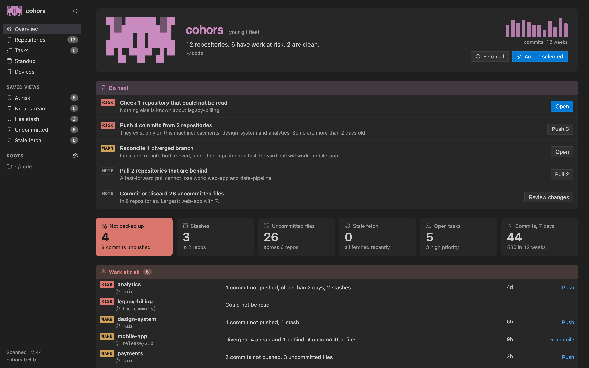
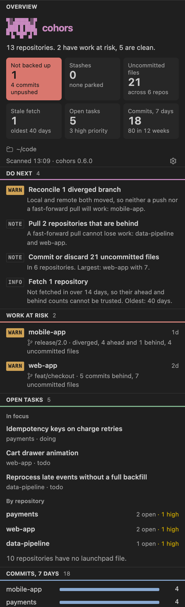

# cohors for VS Code

**Every git repo you own, on one screen.** What's unpushed, what's behind, what's about to be lost, and what to do next, across every repository on your machine, without leaving the editor.



## Before you start: install cohors

The extension shows what the `cohors` command-line tool reads, so install that first, any way you like:

```sh
brew install rushirb2001/tap/cohors
```

```sh
pip install cohors
```

```sh
npm install -g @cohors/cli
```

```sh
cargo install cohors
```

It runs on macOS and Linux and needs `git`. If the extension can't find `cohors`, run **cohors: How to install the cohors command-line tool**, or point `cohors.binaryPath` at it.

## What you get

- **The fleet in the sidebar.** Click the cohors icon in the activity bar: what to do next, work at risk, open tasks, this week's commits and every repository, as native panes.
- **The full dashboard in a tab.** Run **cohors: Open dashboard**.
- **Act from where you are.** Push, pull or fetch any step or repository, open it in a new window, or open a terminal there.
- **Run a repo's commands.** The commands a repository declares (or that cohors detects from npm, Cargo, uv, Makefiles and Gradle) run in a VS Code terminal with one click.
- **Start Claude on a task.** Each task has a button that opens Claude Code (or Codex, Gemini CLI or agy) in a terminal, briefed on that task. Run it again and it resumes the same conversation.



## Commands

| Command | Does |
|---|---|
| cohors: Open dashboard | The full dashboard in a tab |
| cohors: Refresh | Scan again now |
| cohors: Fetch every repository | `git fetch` everywhere |
| cohors: Set up this repo with an agent | Your agent writes this repo's launchpad file |
| cohors: Plan my day with an agent | Your agent plans your focus across every repo |
| cohors: Use this workspace's folders as roots | Scan the folders open in this window |
| cohors: Show the launchpad contract | The format a repo's `.cohors/repo.json` follows |

## Settings

| Setting | Default | |
|---|---|---|
| `cohors.roots` | `[]` | Folders to scan. Empty uses your cohors config. |
| `cohors.binaryPath` | | Where `cohors` is, if it isn't on your `PATH` |
| `cohors.refreshSeconds` | `30` | How often the focused dashboard refreshes; `0` turns it off |
| `cohors.openOnStartup` | `off` | What cohors opens when a window starts |

## Safe by default

`pull` is fast-forward only and nothing force-pushes. In an untrusted workspace the extension reads but runs nothing. cohors has no telemetry: see the [privacy policy](https://github.com/rushirb2001/cohors/blob/main/PRIVACY.md).

## More

cohors is also a terminal dashboard, a browser dashboard and an MCP server for your coding agent. See the [project on GitHub](https://github.com/rushirb2001/cohors), and [open an issue](https://github.com/rushirb2001/cohors/issues) for anything you'd like it to do.
